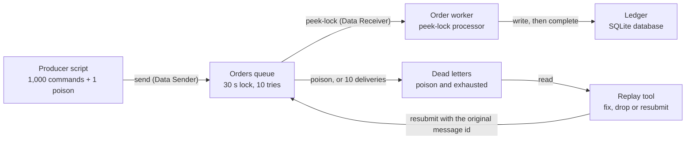

# Architecture: the Service Bus order worker

The worker shows three behaviors of a peek-lock consumer on purpose and fixes each: duplicates from lock expiry, lost order across instances, and messages that can never succeed. This document names the parts, shows the flow, explains the choices and says where the teaching build stops short of production.

## Components and what each owns

Names match the lesson's diagram ("The Service Bus worker you build").

| Component (lesson name) | Azure resource or code | Owns | Where |
|---|---|---|---|
| Producer script | `order-produce`, run with your `az login` identity | The known set: 1,000 commands for 20 customers (50 each, a sequence number per customer) and one poison command | `application/produce_orders.py`, `interfaces/produce_cli.py` |
| Orders queue | Service Bus queue `orders` (and `orders-sessions` with sessions), Standard tier, 30 s lock, 10 deliveries | Peek-lock delivery, delivery counts, per-customer sessions | `infra/modules/servicebus` |
| Order worker | `order-worker`, locally or as the container app `ca-orders-worker` | Validate, write, then settle each message; renew locks; shut down gracefully | `application/handle_delivery.py`, `application/run_worker.py` |
| Dead letters | the queue's dead-letter sub-queue | Poison and exhausted messages, with reason and description | the queue itself |
| Ledger | SQLite file (`data/orders.db`) | One row per applied command; the `processed_messages` table in step 3 | `sql/`, `infrastructure/sqlite_ledger.py` |
| Replay tool | `order-dlq` | Read the dead-letter queue; fix, drop or keep each message; resubmit with the original id | `application/replay_dead_letters.py` |
| Checker | `order-check`, `sql/003_queries.sql` | The lesson's correct end state as a function of the ledger | `application/check_ledger.py` |
| Roles | Azure RBAC | Worker: Data Receiver on each queue. Operator: Data Sender and Data Receiver on each queue. Never the namespace-wide owner role | `infra/modules/role_assignments` |

Inside the application (`src/order_worker/`):

| Layer | Holds | May import |
|---|---|---|
| `domain` | `OrderCommand` and its parsing/validation, `is_next_in_sequence`, `repair_body`, `Mode`, `Chaos`, named errors | the standard library |
| `application` | `HandleDelivery`, `RunWorker`, `ProduceOrders`, `ReplayDeadLetters`, `CheckLedger`, and the ports `Delivery`, `Receiver`, `Inbox`, `Sender`, `Ledger`, `LedgerReader`, `Clock` | domain |
| `infrastructure` | Service Bus adapters, SQLite ledger, simulated broker and scenarios, settings, JSON logging, health server, shutdown | domain, application, SDKs |
| `interfaces` | the five programs | everything above; nothing imports them |

## Pattern: ports and adapters, with a simulator behind the same ports

The system has three boundaries: the broker (Service Bus), the ledger (SQLite) and the clock. Each is a port in the application layer. That gives three things the lesson needs:

1. **Failures on demand.** The simulated broker implements `Inbox`, `Receiver`, `Delivery` and `Sender` with a manual clock, so "processing takes 45 seconds against a 30-second lock" runs in milliseconds and gives the same answer every time.
2. **The real SDK in one file.** `infrastructure/servicebus.py` is the only module that imports `azure.servicebus`; `import-linter` enforces it.
3. **Honest tests.** The use cases are tested with hand-written fakes; the adapter is tested against SDK stubs; the SQLite ledger is tested for real, including four processes writing one file.

## Data flow

Drawn versions of this figure and of the walk-through: [the architecture](docs/diagrams/architecture.svg) and [one run](docs/diagrams/flow.svg).

### One command, step by step

1. The producer sends `o-c01-010` (customer `c01`, sequence 10, amount 10.0) with `message_id = o-c01-010`, and with `session_id = c01` on the session queue.
2. A worker's receiver takes the message under a peek-lock: it is hidden from other receivers for 30 seconds and its delivery count becomes 1. On the session queue the receiver first locks the next session that has messages, and then receives only that customer's commands, in order.
3. `HandleDelivery` parses and validates the body. A body that can never be valid (`InvalidAmount`, `MalformedCommand`) is dead-lettered at once with a reason and a description; nothing is written.
4. Otherwise the ledger writes the row. In idempotent mode the same transaction first inserts the message id into `processed_messages`; if it is already there, the transaction writes nothing and reports a repeat.
5. The worker compares the customer's previous sequence number (read in the same transaction) with this one; a command that does not follow its predecessor is logged as `out of order` and still applied, so the final check can show it.
6. Only after the commit, the worker completes the message. If the lock expired meanwhile, `complete` fails: the worker logs `the lock supplied is invalid` and moves on. The row exists; the queue will deliver the message again; idempotent mode will skip it.
7. After ten deliveries without completion, the queue dead-letters the message itself with `MaxDeliveryCountExceeded`.
8. The operator runs `order-dlq`. A fixed message is sent to the main queue first (same message id, same session id) and only then completed in the dead-letter queue, so a crash between the two loses nothing.

## Decisions and trade-offs

1. **Complete after the commit, never before.** The only order that cannot lose a command: a crash after the commit redelivers (a repeat the ledger absorbs); a crash before it also redelivers (nothing to absorb). Completing first would lose the command on a crash.
2. **Naive mode exists to be broken.** The lesson needs the duplicate effect to be visible, so the ledger has no unique key on `order_id` and `Mode.NAIVE` skips the dedupe. The production mode is the default (`MODE=idempotent`).
3. **Idempotency key = the producer's message id, recorded in the same transaction.** One transaction makes "applied" and "recorded as applied" one fact. A separate check-then-insert would race between two workers. The replay tool keeps the id, so resubmitting is safe too.
4. **Keep both lock renewal and idempotence.** Renewal removes the common cause (slow work) and avoids wasted repeats; idempotence covers what renewal cannot (a crash after the commit, a renewal that fails, a network drop). `test_step_3_a_crash_after_the_commit_*` is the case only idempotence handles.
5. **Sessions keyed by customer id.** One receiver holds a session at a time, so a customer's commands are handled in order; different customers run in parallel. The cost is that one slow command stalls its customer's whole session (the simulation's stalled worker shows exactly this, and that nothing is reordered). `requires_session` cannot be changed on an existing queue, so the session queue is a second queue.
6. **Dead-letter explicitly, with a reason.** `abandon` would put a poison message back for ten wasted attempts and a delay behind it. The explicit dead letter moves it at once and records why.
7. **Transient failures abandon; permanent ones dead-letter.** `TransientError` (the ledger is busy) abandons; `PermanentError` (invalid body, unknown customer) dead-letters. The classes make the policy a type, not a convention.
8. **Money in integer cents.** `Decimal` at the boundary, `INTEGER` in the table, exact totals. The lesson's "10000.0" is `SUM(amount_cents) / 100.0`.
9. **Entra ID only on the namespace.** `local_auth_enabled = false` disables shared access signatures, so no connection string exists to leak. The programs use `DefaultAzureCredential`; the worker's container app attaches two identities (worker and image pull) and `AZURE_CLIENT_ID` picks the one the code uses.
10. **A health server because probes speak HTTP.** Container Apps probes are HTTP or TCP, not shell commands. `/live` fails when the receive loop makes no progress for four wait periods (a hung call), `/ready` also checks the ledger.
11. **Terraform tests against a mocked provider.** A real `azurerm` plan needs a signed-in session even for create-only changes; mocked tests assert who holds which role on which queue and which settings the worker gets. They do not prove Azure accepts the resources.

## Failure modes the lesson teaches, and how to see each

| Failure | Signal | See it offline | See it on Azure |
|---|---|---|---|
| Lock expiry: processing outlasts the 30 s lock | `delivery_count` above 1 in the log; `the lock supplied is invalid` on complete; duplicate rows in naive mode | `make demo-duplicates` | step 2 in README Deploy |
| Lost order: a customer's commands applied out of sequence | a gap or inversion in `seq` per customer; `out of order` in the worker log; query 4 in `sql/003_queries.sql` | `make demo-sessions` (first run) | step 4 without sessions |
| Poison: a message that can never succeed | dead-letter count above 0 (the alert rule, `scripts/show-queues.sh`) | `make demo-poison` | step 5 |
| Retries exhausted | `MaxDeliveryCountExceeded` in the dead-letter reason | `test_a_message_that_keeps_failing_*` | make the ledger fail on purpose |
| Crash between commit and complete | redelivery of an already-applied message | `test_step_3_a_crash_after_the_commit_*` | kill the worker with `kill -9` mid-run |
| Role missing | the worker's receive is denied (`Unauthorized`/`Forbidden`) in the log | n/a | remove Data Receiver from the worker identity |

## Limits of the teaching build against production

- **The simulated broker is a model.** It reproduces peek-lock, lock expiry, delivery counts, maximum-delivery dead-lettering, explicit dead-lettering, sessions (one holder per session) and the dead-letter sub-queue. It has no message expiry, no scheduled messages, no duplicate detection, no prefetch, no partitioned entities, and a session lock does not expire on its own (the real one does after the lock duration without renewal). The first run against Azure is the check of the model.
- **The ledger is a single SQLite file.** Several local processes share it safely (WAL, `BEGIN IMMEDIATE`, a busy timeout that becomes a transient error), but replicas in Azure would each have their own. A production ledger is a networked database where the same transaction pattern holds.
- **The container app keeps its ledger on an ephemeral volume** and has a fixed replica count; production scales on queue length (KEDA's Service Bus scaler) and stores results elsewhere.
- **No private endpoint.** Standard has none; Premium does.
- **Lock renewal is the SDK's `AutoLockRenewer`** with a fixed maximum; real systems also cap total processing time and dead-letter work that exceeds it.

## How to extend it

- **Receive-and-delete mode** in the simulator (remove at receipt) to show which messages a crash loses; the `Delivery` port stays the same.
- **Scheduled retry:** `abandon_later(seconds)` on the port, implemented with a scheduled message, replacing the immediate abandon for transient errors.
- **Event Hubs instead of a queue:** partitions replace sessions for ordering (a partition key per customer), consumers track an offset in a checkpoint store instead of settling messages, and replay is rewinding the offset rather than resubmitting from a dead-letter queue; there is no per-message lock, so no lock expiry, and idempotence matters even more.
- **KEDA scaling:** a scale rule on `orders` queue length, authenticated by the worker identity, with the ledger moved to a database all replicas share.
